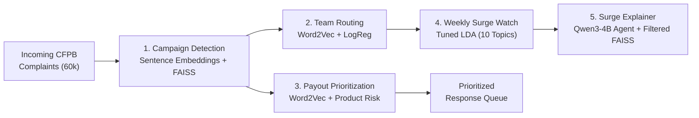
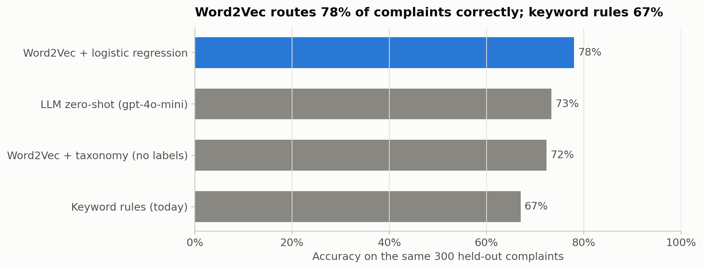
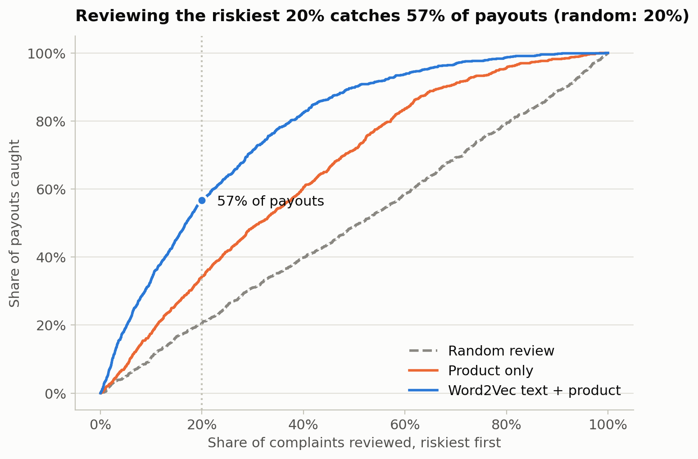
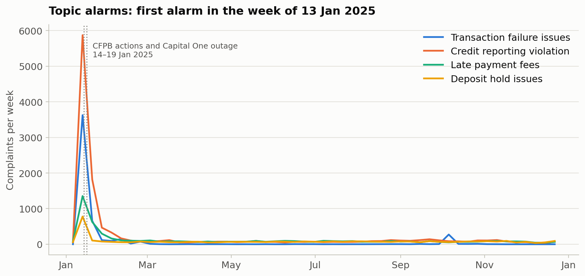
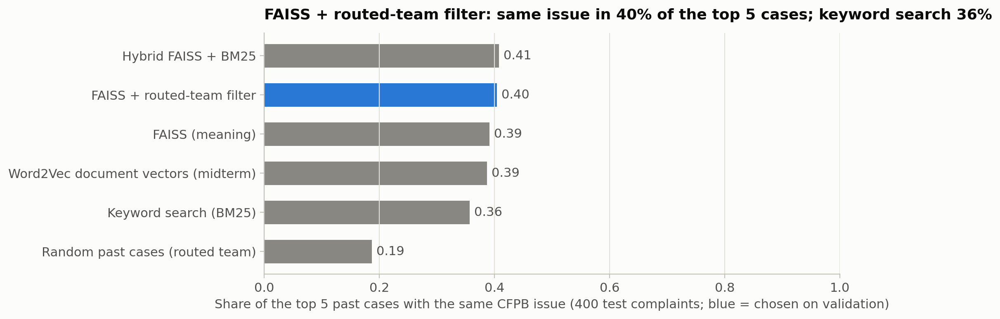
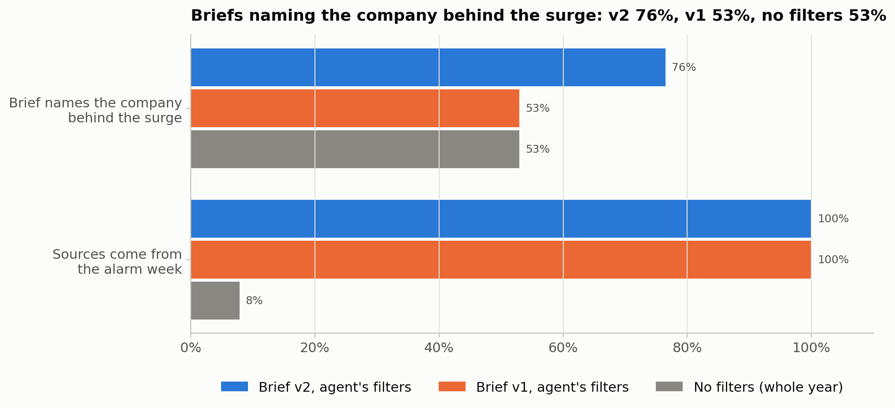

# bank-complaint-intelligence

End-to-end NLP, topic modeling, and agentic RAG pipeline that deduplicates, routes, prioritizes, monitors, and explains retail banking consumer complaints from the CFPB.

Built on **60,000** 2025 CFPB complaint narratives across five retail banking products (*Checking/savings*, *Credit cards*, *Money transfers*, *Mortgages*, and *Vehicle loans*), with a stratified **70 / 10 / 20** train / validation / test split.

---

## Architecture



---

## Evaluation Scorecard

All metrics are measured on held-out test data or dated real-world January 2025 CFPB enforcement/outage events (full tables in [`results/`](results/)).

| Stage | Model / Method | Metric | Baseline | Result |
| --- | --- | --- | --- | --- |
| **1. Find Campaigns** | Sentence embeddings + FAISS + shared-wording check | Human-confirmed copy pairs | Exact match (10,906 copies) | **19 / 20** pairs confirmed (`16,392` copies) |
| **2. Route** | Word2Vec + Logistic Regression | Test accuracy (`n = 8,722`) | Keyword rules `72%` | **82%** (`81%–83%`), macro-F1 **0.83** |
| **2. Route (LLM compare)** | Word2Vec vs. zero-shot `gpt-4o-mini` | Held-out accuracy (`n = 300`) | Keyword `67%`, `gpt-4o-mini` `73%` | **78%** |
| **3. Prioritise** | Word2Vec text + product Logistic Regression | Payouts caught in riskiest `20%` | Random `20%`, product-only `34%` | **57%** (`53%–60%`), fairness gap **0.0 pts** |
| **4. Watch** | Tuned LDA (`10` topics, unigrams) | Topic coherence (`c_v`) / NMI | Untuned `0.48` / `0.22` | **0.51** coherence / **0.24** NMI |
| **4. Watch (Events)** | Weekly LDA surge alarms | Alarms explained by dated event/campaign | — | **17 / 17** alarms; catches **3** surges hidden from raw volume |
| **5. Explain (Search)** | FAISS + routed-team filter | Precision@5 (same CFPB issue, `n = 400`) | BM25 `0.36`, random `0.19` | **0.40** (`0.37–0.44`) |
| **5. Explain (Agent)** | `Qwen/Qwen3-4B` (prompt v2) | Agent routing test checks (`16` + `8` held-out) | Prompt v1 `84%` / `88%` | **97%** test / **100%** held-out |
| **5. Explain (Briefs)** | `Qwen/Qwen3-4B` + agent filters (v2) | RAGAs faithfulness / judge usefulness | Brief v1 `0.93` / `3.57` | **0.98** faithfulness / **3.86 / 5** usefulness |
| **5. Explain (Honesty)** | Brief company attribution (`17` alarms) | Surge briefs naming the company | No filters `53%` (target `≥ 80%`) | **76%** *(target missed)* · **2 / 3** Jan events named |

---

## Visual Highlights

### Team Routing vs. Zero-Shot LLM & Keyword Rules


### Payout Risk Prioritization (Cumulative Gains)


### Weekly LDA Topic Surge Alarms (Jan 2025 CFPB & Outage Events)


### Retrieval Precision & Impact of Agent Filter Routing



*(All 13 exported evaluation figures live in [`docs/figures/`](docs/figures/).)*

---

## Data

- **Source:** [CFPB Consumer Complaint Database narratives archive](https://www.consumerfinance.gov/foia-requests/foia-electronic-reading-room/cfpb-consumer-complaint-database-narratives-archive/) (2025 exports 9–14).
- **Sample:** Random sample (`seed = 42`) of **60,000** retail-banking narratives out of 183,544 in-scope 2025 records, stored zipped at [`data/cfpb_bank_complaints_2025.zip`](data/cfpb_bank_complaints_2025.zip).
- **Rebuilding from raw exports:** Place raw `CCDB_Export_*_2025.zip` files in `data/raw/` and run `python scripts/prepare_dataset.py`.

---

## Run

The full pipeline runs end-to-end in [`notebooks/complaint_intelligence.ipynb`](notebooks/complaint_intelligence.ipynb) (designed for a Google Colab **T4 GPU** runtime, or locally with CUDA):

```bash
python -m venv .venv
.venv\Scripts\activate          # macOS/Linux: source .venv/bin/activate
pip install -r requirements.txt
jupyter lab notebooks/complaint_intelligence.ipynb
```

Configuration switches inside the notebook:
- `QUICK_RUN = True` — runs on a 6,000-complaint subset for fast verification.
- `RUN_OPENAI = False` — skips optional `gpt-4o-mini` routing comparison and RAGAs/LLM-judge scoring (requires `OPENAI_API_KEY`).
- `RUN_QWEN` — automatically runs `Qwen/Qwen3-4B` when a GPU is available.

---

## Layout

```text
.
├── config/
│   └── taxonomy.json                    # Zero-shot keyword taxonomy for routing baseline
├── data/
│   └── cfpb_bank_complaints_2025.zip    # 60,000 sampled 2025 CFPB bank complaints
├── docs/
│   └── figures/                         # 13 evaluation charts (PNG)
├── notebooks/
│   └── complaint_intelligence.ipynb     # Full pipeline notebook with saved outputs
├── results/
│   ├── scorecard.csv                    # Target vs. actual evaluation scorecard
│   ├── model_comparison.csv             # Baseline vs. model comparison table
│   └── ...                              # Stage-level evaluation CSVs
└── scripts/
    └── prepare_dataset.py               # Rebuilds the 60k sample from raw CFPB exports
```

---

## Credits

Originally developed as a group capstone by **Yohannes Belay Woldeyes**, **Vidak Vukadinovic**, and **Jorge Plaza de los Reyes Álvarez**.

Licensed under the [MIT License](LICENSE).
